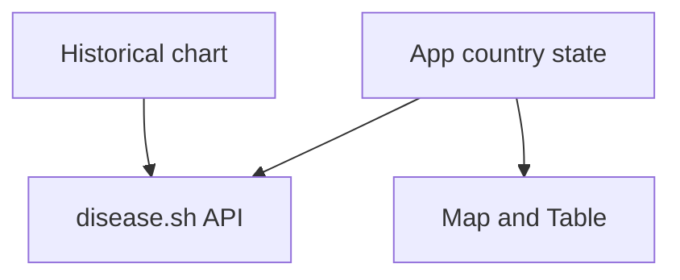
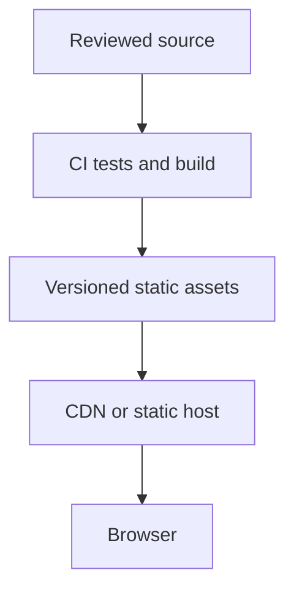

# COVID reported-data explorer: architecture and maintenance

Reviewed against base commit `24c501262278df533f3e0dc7db4c787ab2eed7dc`. Maintenance dated 11 November 2026 is AI-assisted; it does not change the original learning-project provenance.

## Implemented system

This repository is a React/Leaflet/Chart.js public aggregate-data learning project. `App.js` owns selected country and summary data; `Map.js` and `util.js` render country circles; `Table.js` renders sorted totals; `LineGraph.js` retrieves history and delegates deltas to `chartData.js`.

The diagram describes source boundaries, not a verified live deployment. No load test, throughput, uptime or customer impact result is claimed.

## Maintenance change

Country requests now follow selected state, cancel replaced responses and display HTTP/network failures. Worldwide selection restores a safe map center instead of accessing absent countryInfo. Declared Material dependencies match imports. Chart deltas preserve a zero previous total and skip invalid gaps. Invalid map coordinates are filtered.

## Run and verify

`npm ci && CI=true npm test -- --watchAll=false --runInBand && CI=false npm run build`; `npm start` for preview.

Delta regressions cover zero, missing series and invalid gaps. The build validates the declared Material imports. Country switching still needs browser/visual review against provider fixtures.

## Scaling design and operating limits

Cache country snapshots and history centrally with explicit source timestamps and stale-data banners. Bound the selectable history window and cluster/vectorize map rendering when datasets grow. Measure rendering and request budgets before selecting thresholds.

Proposed delivery boundary (not provisioned by this change):

For changes, keep UI components separate from I/O and pure data transforms. Retain lockfiles, test failure/empty/partial data paths, and review provider/dependency compatibility before changing versions. Reproduce a failing input with a small fixture before adding more infrastructure. Release only after checks pass; keep the previous artifact/commit for rollback.

## Remaining limits

The external reporting series may be stale or incomplete. This interface is an aggregate-data prototype, not a clinical, public-health or real-time decision service. The historic React-Leaflet/Chart.js versions require a separate compatibility migration before production.

Legacy dependencies and external media/API behavior are not comprehensively remediated by this maintenance pass. Document real limits and measure behavior before making capacity claims.
